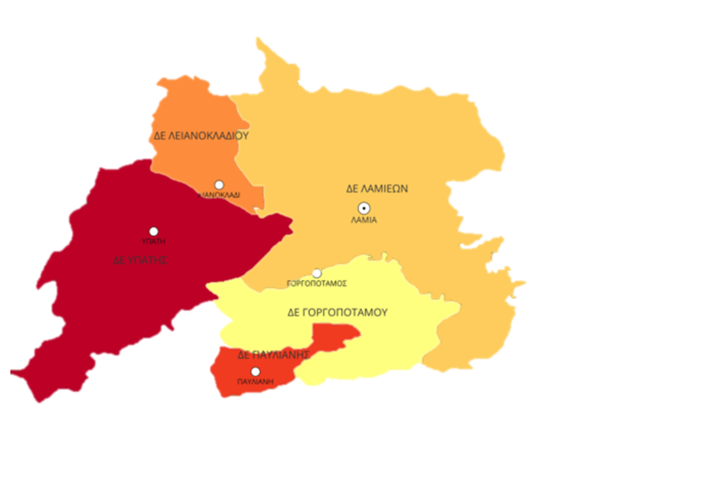
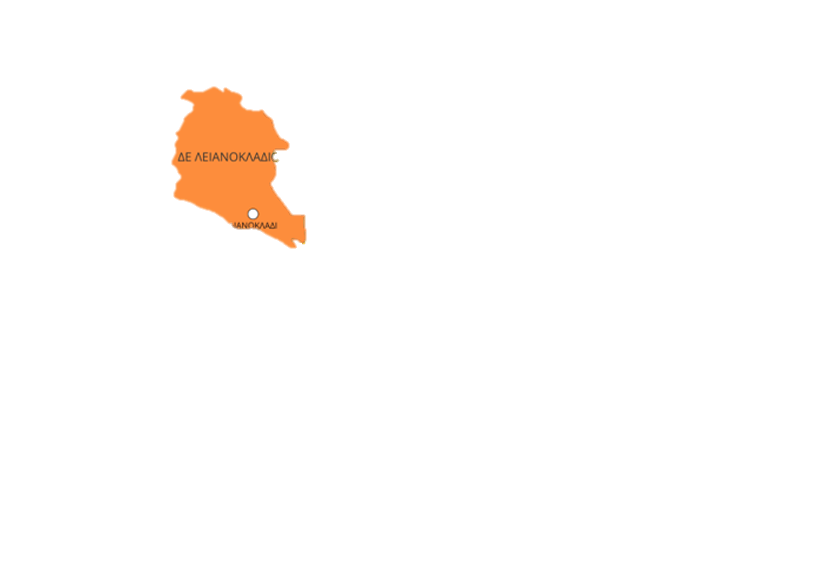
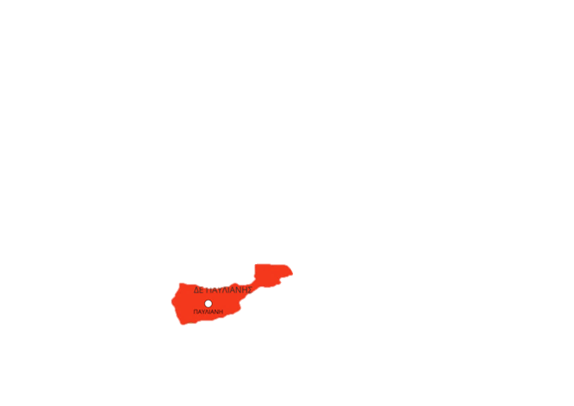
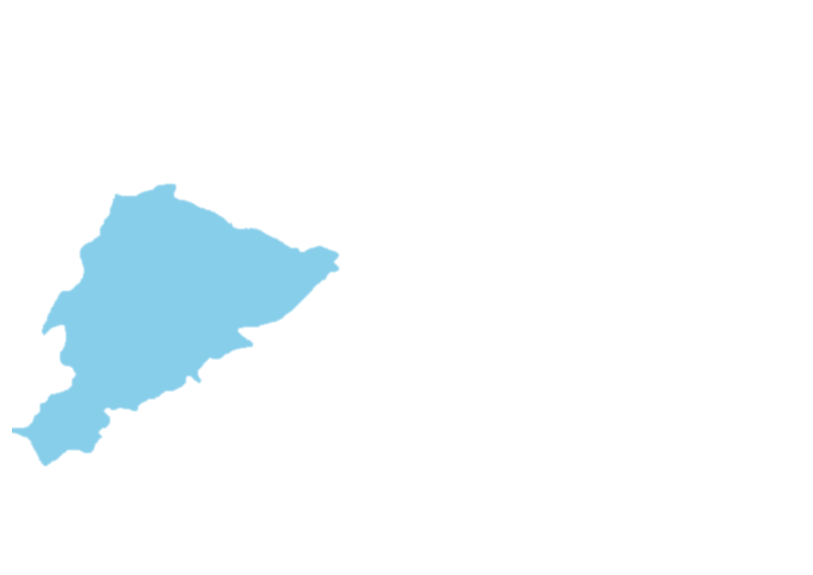
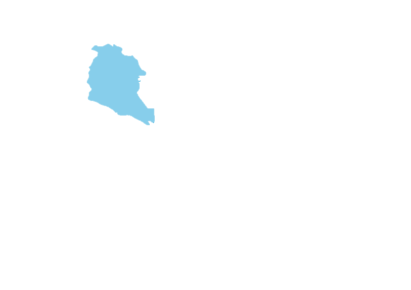
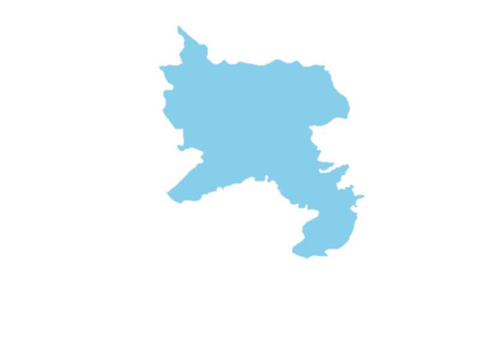
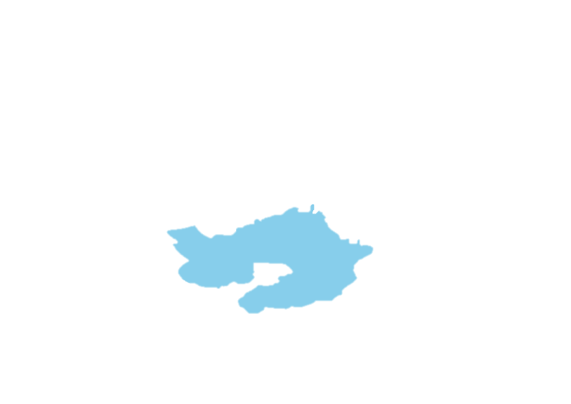
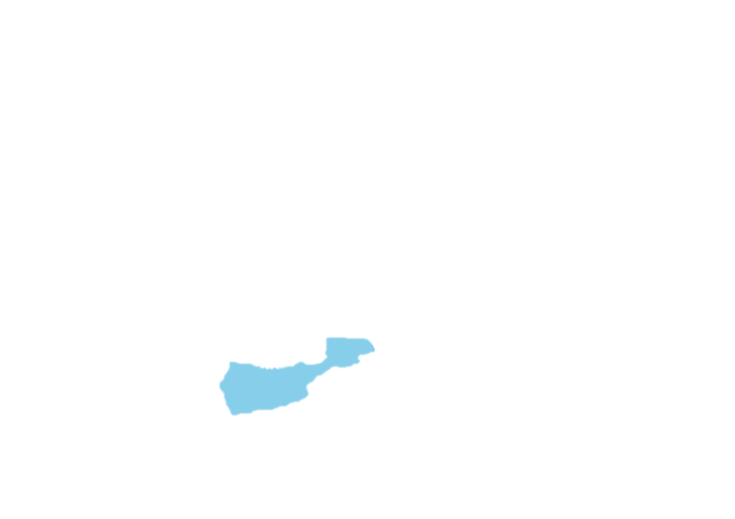

# Lamia SVG – Διαδραστικός Χάρτης

## Περιγραφή του Project

Το συγκεκριμένο project αφορά τη δημιουργία ενός διαδραστικού χάρτη (Interactive Map) του Δήμου Λαμιέων, με επίκεντρο τις πέντε Δημοτικές Ενότητες (Δ.Ε.) που τον αποτελούν.

Η εργασία ξεκίνησε από τον γεωγραφικό χάρτη του Νομού Φθιώτιδας, από τον οποίο απομονώθηκε ο Δήμος Λαμιέων.

  

  

  

  

  

  

## Δημοτικές Ενότητες

Ο Δήμος Λαμιέων αποτελείται από τις παρακάτω πέντε Δημοτικές Ενότητες:

1. **Υπάτης**
2. **Λιανοκλαδίου**
3. **Λαμιέων**
4. **Γοργοποτάμου**
5. **Παύλιανης**

  

  

  

  

  

## Επεξεργασία Χάρτη

Η διαδικασία που ακολουθήθηκε:

1. Χρησιμοποιήθηκε ως αρχικό υλικό ένας γεωγραφικός χάρτης του Δήμου Λαμιέων.
2. Ο χάρτης επεξεργάστηκε και διαχωρίστηκε γεωγραφικά στις πέντε Δημοτικές Ενότητες.
3. Κάθε Δημοτική Ενότητα απομονώθηκε και μετατράπηκε σε ξεχωριστό αρχείο SVG.
4. Τα επιμέρους SVG προορίζονται για χρήση σε εφαρμογή, όπου κάθε Δημοτική Ενότητα μπορεί να αναγνωρίζεται και να χρωματίζεται ανεξάρτητα.

## Δομή Αρχείων

| Αρχείο / Φάκελος | Περιγραφή |
|---|---|
| `lamia.svg` | Ο αρχικός χάρτης του Δήμου Λαμιέων. |
| `blue_svgs/` | SVG αρχεία με μπλε χρωματισμό. |
| `done_svgs/` | Τα επεξεργασμένα SVG των Δημοτικών Ενοτήτων. |
| `recolor_svg.py` | Python script για τον χρωματισμό των SVG σε μπλε αποχρώσεις. |

## Σκοπός

Στόχος είναι η δημιουργία ενός διαδραστικού γεωγραφικού χάρτη, στον οποίο οι πέντε Δημοτικές Ενότητες θα αποτελούν ανεξάρτητα και επεξεργάσιμα στοιχεία.

Με αυτόν τον τρόπο, κάθε ενότητα θα μπορεί να χρωματίζεται, να επιλέγεται και να χρησιμοποιείται ξεχωριστά μέσα στην εφαρμογή.
